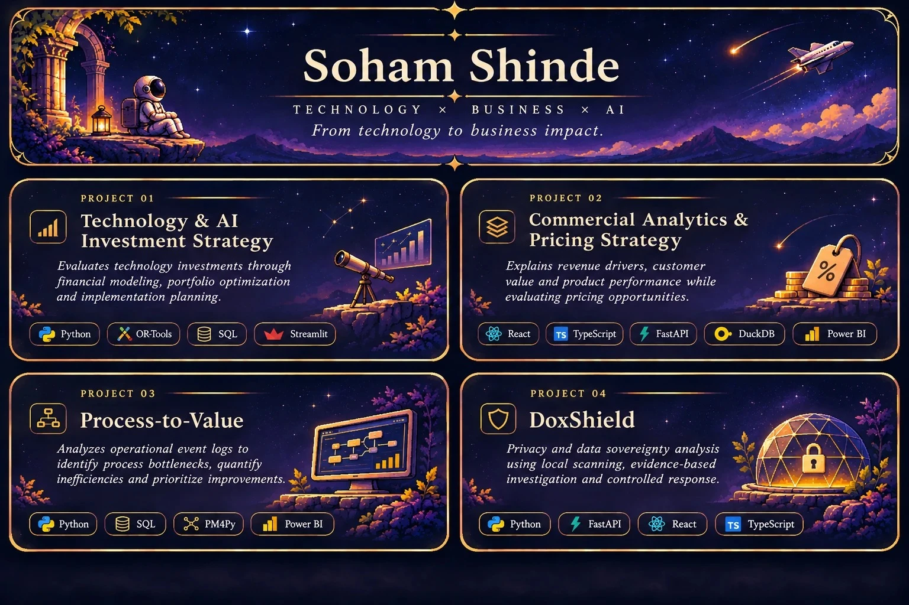
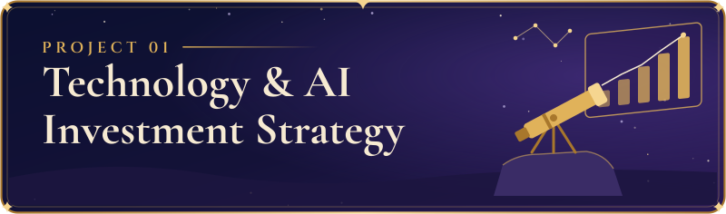
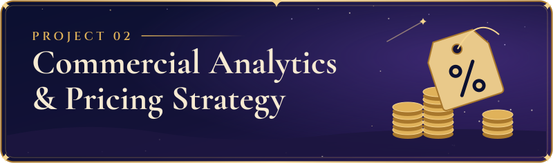
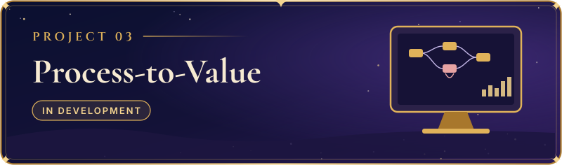

  

 

  

I'm pursuing an M.Sc. in Management and Engineering at RWTH Aachen University, after more than two years as a software engineer on enterprise teams. The work I enjoy most sits where a technical answer has to hold up as a business answer: which initiative deserves the budget, what is really moving revenue, where a process loses time, and which privacy risk needs a closer look. I build working systems for those questions, so decisions rest on evidence that people can inspect.

<table>
  <tr>
    <td width="56" align="center"></td>
    <td><b>Studying</b> M.Sc. Management and Engineering (MME-TIME), RWTH Aachen University B.Tech Information Technology, Savitribai Phule Pune University</td>
  </tr>
  <tr>
    <td align="center"></td>
    <td><b>Experience</b> AI Software Engineer at Softcane Solutions · Associate Software Engineer at HHAeXchange Enterprise AI features, backend services, technical requirements, LLM evaluation and production performance</td>
  </tr>
  <tr>
    <td align="center"></td>
    <td><b>Building</b> Investment decision platforms, commercial analytics, process analysis and privacy tools</td>
  </tr>
  <tr>
    <td align="center"></td>
    <td><b>Heading toward</b> Technology strategy, digital transformation, business analytics, innovation and applied AI</td>
  </tr>
</table>

 

  

**Business Analytics & Strategy**

  
  
  
  
  
  

**Applied AI**

  
  
  
  

**Engineering & Data**

  
  
  
  
  
  
  

**Development & Delivery**

  
  
  
  
  

 

  

<b>TECHNOLOGY STRATEGY &amp; AI TRANSFORMATION</b> <i>Where should limited technology budgets go?</i>

Built a technology investment platform that prioritizes initiatives under budget and resource constraints, plans quarterly delivery, and tracks realized benefits against targets to support investment decisions and management oversight. Monte Carlo scenarios, a citation-first research assistant with human accept/reject review, and an EU AI Act screening step feed into each investment case.

  
  
  
  
  

Repository not yet public

 

<b>BUSINESS ANALYTICS &amp; PRICING</b> <i>What is actually driving revenue and customer value?</i>

Built a commercial analytics platform that processes over 1 million retail transactions to explain revenue changes, evaluate customer value and identify pricing opportunities through validated reporting and five interactive decision views. It reconciles £18.98M in net product revenue and reaches 0.873 macro-F1 on held-out product classification. It also reports where the evidence stops: a historical baseline outperformed the customer-value model, and the pricing test lacked the power to confirm a 5% uplift.

  
  
  
  
  

Repository not yet public

 

<b>PROCESS MINING &amp; OPERATIONS</b> <i>Where are operational workflows breaking down?</i>

In development: a process analysis of purchase-to-pay procurement event logs, designed to show where workflows stall, where work loops back as rework, and which improvement opportunities deserve attention first. The aim is to make a complex operational workflow understandable enough to prioritize.

Planned stack: Python · SQL · PM4Py · BPMN

 

<b>PRIVACY ENGINEERING &amp; APPLIED AI</b> <i>Which privacy risks need a human to look closer?</i>

Built with Team Exxeta1 for the Q-Hack 2026 Exxeta challenge: a macOS app that scans installed apps, network connections, cookies and permissions, scores data-sovereignty risk across four evidence layers, and reviews privacy policies with a locally hosted model. People see the evidence behind each finding before they decide how to respond.

  
  
  
  
  

<a href="https://github.com/sohamshindework/DoxShield-Exxeta1"><b>View repository →</b></a>

 

  

  
  
  

  

