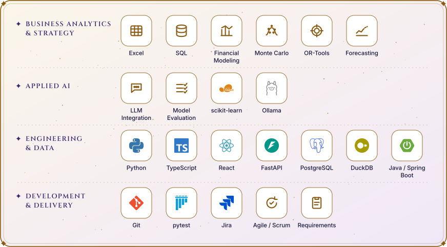
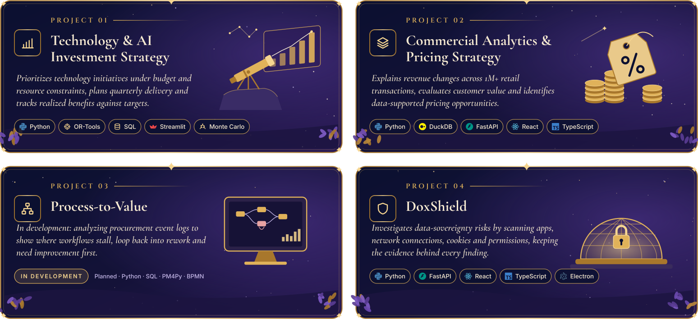

  

 

<picture><source media="(prefers-color-scheme: dark)" srcset="assets/profile/dark/heading-about.svg"></picture>

<picture><source media="(prefers-color-scheme: dark)" srcset="assets/profile/dark/about-study.svg"></picture>&nbsp; I'm pursuing an <b>M.Sc. in Management and Engineering (MME-TIME) at RWTH Aachen University</b>, building on a B.Tech in Information Technology.

<picture><source media="(prefers-color-scheme: dark)" srcset="assets/profile/dark/about-experience.svg"></picture>&nbsp; I bring <b>2+ years of enterprise software engineering</b> from Softcane Solutions and HHAeXchange: enterprise AI features, backend services, technical requirements, LLM evaluation and production performance.

<picture><source media="(prefers-color-scheme: dark)" srcset="assets/profile/dark/about-build.svg"></picture>&nbsp; I build <b>tools that connect technical analysis with business decisions</b>, from technology investment prioritization and commercial analytics to process analysis and privacy investigation.

<picture><source media="(prefers-color-scheme: dark)" srcset="assets/profile/dark/about-direction.svg"></picture>&nbsp; <b>Looking to contribute in technology strategy, digital transformation, business analytics and applied AI.</b>

 

<picture><source media="(prefers-color-scheme: dark)" srcset="assets/profile/dark/heading-stack.svg"></picture>

<picture>
<source media="(prefers-color-scheme: dark) and (max-width: 560px)" srcset="assets/profile/dark/stack-board-mobile.svg">
<source media="(max-width: 560px)" srcset="assets/profile/light/stack-board-mobile.svg">
<source media="(prefers-color-scheme: dark)" srcset="assets/profile/dark/stack-board.svg">

</picture>

 

<picture><source media="(prefers-color-scheme: dark)" srcset="assets/profile/dark/heading-projects.svg"></picture>

<picture>
<source media="(max-width: 560px)" srcset="assets/projects/cards-mobile.svg">

</picture>

<a href="https://github.com/sohamshindework/DoxShield-Exxeta1"><b>DoxShield repository →</b></a> &nbsp;·&nbsp; Projects 01–03: repositories not yet public

<b>Project 01 · Technology &amp; AI Investment Strategy</b> — <i>Where should limited technology budgets go?</i>

<b>TECHNOLOGY STRATEGY &amp; AI TRANSFORMATION</b>

Built a technology investment platform that prioritizes initiatives under budget and resource constraints, plans quarterly delivery, and tracks realized benefits against targets to support investment decisions and management oversight. Monte Carlo scenarios, a citation-first research assistant with human accept/reject review, and an EU AI Act screening step feed into each investment case.

Repository not yet public

<b>Project 02 · Commercial Analytics &amp; Pricing Strategy</b> — <i>What is actually driving revenue and customer value?</i>

<b>BUSINESS ANALYTICS &amp; PRICING</b>

Built a commercial analytics platform that processes over 1 million retail transactions to explain revenue changes, evaluate customer value and identify pricing opportunities through validated reporting and five interactive decision views. It reconciles £18.98M in net product revenue and reaches 0.873 macro-F1 on held-out product classification. It also reports where the evidence stops: a historical baseline outperformed the customer-value model, and the pricing test lacked the power to confirm a 5% uplift.

Repository not yet public

<b>Project 03 · Process-to-Value</b> — <i>Where are operational workflows breaking down?</i>

<b>PROCESS MINING &amp; OPERATIONS</b>

In development: a process analysis of purchase-to-pay procurement event logs, designed to show where workflows stall, where work loops back as rework, and which improvement opportunities deserve attention first. The aim is to make a complex operational workflow understandable enough to prioritize.

In development · repository not yet public

<b>Project 04 · DoxShield</b> — <i>Which privacy risks need a human to look closer?</i>

<b>PRIVACY ENGINEERING &amp; APPLIED AI</b>

Built with Team Exxeta1 for the Q-Hack 2026 Exxeta challenge: a macOS app that scans installed apps, network connections, cookies and permissions, scores data-sovereignty risk across four evidence layers, and reviews privacy policies with a locally hosted model. People see the evidence behind each finding before they decide how to respond.

<a href="https://github.com/sohamshindework/DoxShield-Exxeta1">View repository →</a>

 

  
  
  

  

